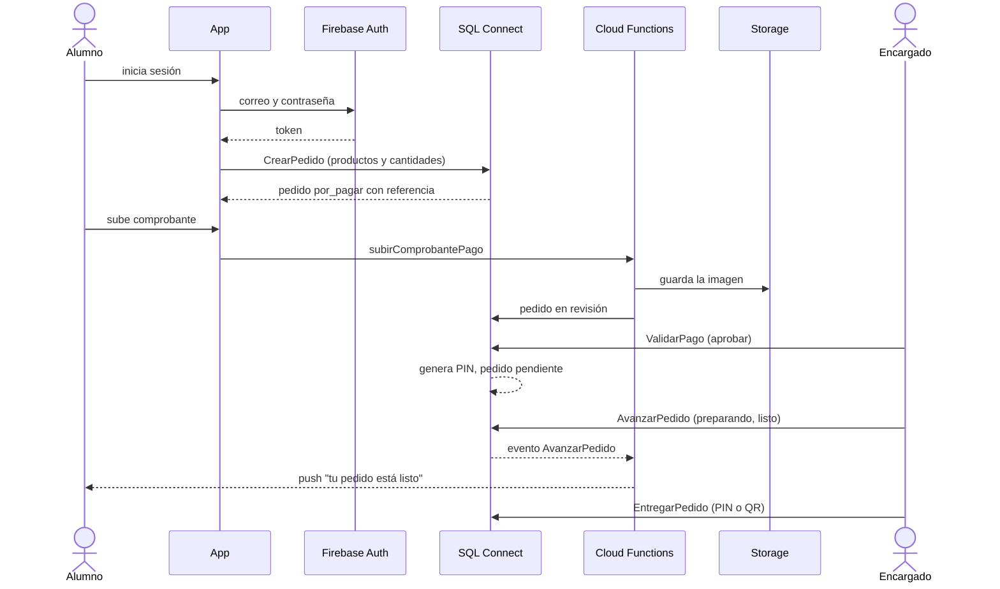

# Integración con servicios en la nube

Proyecto de Firebase: `agilu-a232a` (plan Blaze). Región de SQL Connect y de las
funciones: `us-east4`.

## Servicios

| Servicio | Para qué se usa | Datos que intercambia | Configuración | Límites de acceso |
| --- | --- | --- | --- | --- |
| **Firebase Authentication** | Registro e inicio de sesión con correo y contraseña | Correo, contraseña (solo hacia Firebase), uid y token de sesión | Proveedor correo/contraseña activo en la consola | El token identifica al usuario en todas las demás llamadas |
| **Firebase SQL Connect** (PostgreSQL en Cloud SQL) | Base de datos de la app: cafeterías, estaciones, productos, pedidos, pagos, entregas, avisos | Catálogo, pedidos (productos y cantidades), estados, referencia de pago, URL del comprobante, PIN de entrega, totales del reporte | `dataconnect/` (esquema, conector `agilu`, `dataconnect.yaml`). Se publica con `firebase deploy --only dataconnect` | Cada operación tiene `@auth`. Ver la tabla de operaciones abajo |
| **Cloud Functions** (Node 22) | Lógica que necesita privilegios: subir fotos y comprobantes, cancelar pedidos con productos agotados, avisos push, cierre del día | Imagen en base64 (≤ 1 MB), id de producto o pedido; eventos de mutaciones | `functions/`. Se publican con `firebase deploy --only functions` | Las callables validan la sesión y que el recurso sea del usuario; los disparadores escuchan solo operaciones específicas |
| **Cloud Storage** | Fotos de productos y comprobantes de pago | Archivos JPG/PNG | `storage.rules` | Los clientes no leen ni escriben directo (reglas en `false`); solo las funciones guardan archivos y generan la URL con token |
| **Firebase Cloud Messaging** | Aviso "tu pedido está listo" | Token del dispositivo; título y texto del aviso | `firebase_messaging` en la app; envío desde `functions/avisos.js` | El token se guarda ligado al usuario con sesión y se borra al cerrar sesión o si FCM lo reporta inválido |
| **Cloud Scheduler** (vía `onSchedule`) | Cierre del día a las 23:55 (hora de Ciudad de México) | Ninguno del usuario | `functions/index.js` (`cerrarDia`) | Corre con la cuenta de servicio del proyecto |

## Operaciones de SQL Connect por rol

| Rol | Operaciones |
| --- | --- |
| Cualquier usuario con sesión | `ListarMenu`, `ListarCafeterias`, `OcupacionFranjas` (solo conteos), `MiPerfil`, `CrearPerfil`, `EditarMiPerfil`, `RegistrarDispositivo`, `OlvidarDispositivo` |
| Alumno (dueño) | `EliminarMiCuenta`, `CrearPedido`, `DiagnosticarPedido`, `MiPedido`, `MisPedidos`, `MiConfianza`, `MisNotificaciones`, `MarcarAvisosLeidos` |
| Empleado (de su cafetería) | `PanelPedidos`, `AvanzarPedido`, `EntregarPedido`, `MarcarNoRecogido` |
| Encargado (de su cafetería) | `MiPersonal`, `AgregarEmpleado`, `QuitarEmpleado`, `MisEstaciones`, `CrearEstacion`, `EditarEstacion`, `EliminarEstacion`, `MisProductos`, `CrearMiProducto`, `EditarMiProducto`, `EstablecerDisponibilidad`, `EliminarMiProducto`, `PublicarOferta`, `QuitarOferta`, `MiCafeteria`, `EditarMiCafeteria`, `PanelPedidos`, `AvanzarPedido`, `PagosPorValidar`, `ValidarPago`, `EntregarPedido`, `MarcarNoRecogido` |
| Beneficiaria | `ReporteBeneficiaria` (solo totales) |
| Administrador (rol `admin` en la base) | `CafeteriasAdmin`, `CrearCafeteriaAdmin`, `EditarCafeteriaAdmin`, `PersonalAdmin`, `AsignarRolAdmin` |
| Consola o Admin SDK (`NO_ACCESS`) | `CrearCafeteria`, `CrearPuesto`, `CrearProducto`, `AsignarRol` (para nombrar al primer administrador) |

Para todos los roles, el rol se toma de la base (`Usuario.rol`) y se comprueba en cada
operación; la app solo usa el rol para decidir qué pantalla abrir.

## Valores públicos y secretos

- **Públicos** (pueden estar en la app compilada): id del proyecto, `appId`, API key
  del cliente de Firebase, nombre del servicio de SQL Connect. Aun así
  `firebase_options.dart` no se versiona; se genera con `flutterfire configure`.
- **Secretos** (nunca en el repositorio): llaves de cuentas de servicio, tokens de
  descarga de comprobantes, contraseñas. Las funciones usan las credenciales por
  defecto del entorno de Google Cloud.

## Flujo del pedido

